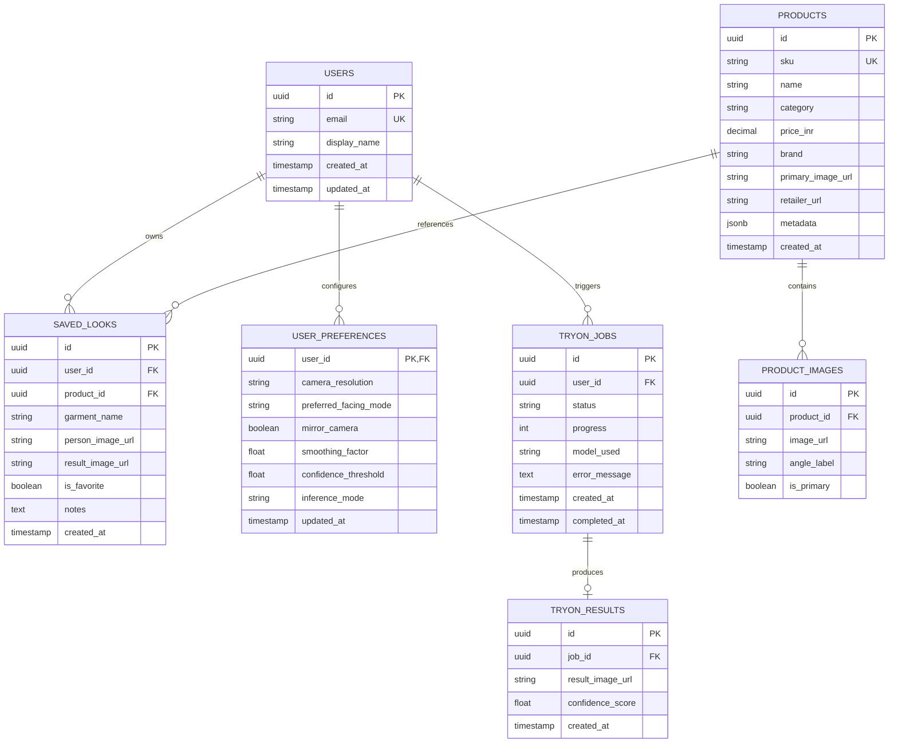

# Database Architecture & Schema Specification

AI Fashion Mirror is designed with a **privacy-by-default local persistence layer** (IndexedDB / LocalStorage) and an **optional enterprise PostgreSQL / Supabase relational schema** for multi-tenant, cloud-synced accounts.

---

## 1. Entity-Relationship Overview



---

## 2. PostgreSQL / Supabase DDL Migration

```sql
-- Enable UUID extension
CREATE EXTENSION IF NOT EXISTS "uuid-ossp";

-- 1. Users Table
CREATE TABLE IF NOT EXISTS users (
    id UUID PRIMARY KEY DEFAULT uuid_generate_v4(),
    email VARCHAR(255) UNIQUE,
    display_name VARCHAR(100) NOT NULL DEFAULT 'Fashion Enthusiast',
    avatar_url TEXT,
    created_at TIMESTAMPTZ NOT NULL DEFAULT NOW(),
    updated_at TIMESTAMPTZ NOT NULL DEFAULT NOW()
);

-- 2. Products Table
CREATE TABLE IF NOT EXISTS products (
    id UUID PRIMARY KEY DEFAULT uuid_generate_v4(),
    sku VARCHAR(64) UNIQUE NOT NULL,
    name VARCHAR(255) NOT NULL,
    category VARCHAR(32) NOT NULL CHECK (category IN ('t-shirt', 'shirt', 'jacket', 'top', 'kurti', 'dress', 'unknown')),
    price_inr NUMERIC(10, 2) NOT NULL DEFAULT 0.00,
    currency VARCHAR(3) NOT NULL DEFAULT 'INR',
    brand VARCHAR(128),
    description TEXT,
    primary_image_url TEXT NOT NULL,
    retailer_url TEXT,
    swatch_gradient VARCHAR(128) DEFAULT 'from-violet-600 to-indigo-700',
    available_sizes TEXT[] DEFAULT ARRAY['S', 'M', 'L', 'XL'],
    rating NUMERIC(3, 2) DEFAULT 4.5,
    in_stock BOOLEAN DEFAULT TRUE,
    created_at TIMESTAMPTZ NOT NULL DEFAULT NOW()
);

-- 3. Product Candidate Images
CREATE TABLE IF NOT EXISTS product_images (
    id UUID PRIMARY KEY DEFAULT uuid_generate_v4(),
    product_id UUID NOT NULL REFERENCES products(id) ON DELETE CASCADE,
    image_url TEXT NOT NULL,
    angle_label VARCHAR(64) DEFAULT 'front',
    is_primary BOOLEAN DEFAULT FALSE,
    created_at TIMESTAMPTZ NOT NULL DEFAULT NOW()
);

-- 4. Virtual Try-On Jobs (Asynchronous Inference)
CREATE TABLE IF NOT EXISTS tryon_jobs (
    id UUID PRIMARY KEY DEFAULT uuid_generate_v4(),
    user_id UUID REFERENCES users(id) ON DELETE SET NULL,
    status VARCHAR(32) NOT NULL DEFAULT 'queued' CHECK (status IN ('queued', 'processing', 'succeeded', 'failed', 'cancelled')),
    progress INT NOT NULL DEFAULT 0 CHECK (progress BETWEEN 0 AND 100),
    model_name VARCHAR(64) NOT NULL DEFAULT 'client-high-res',
    person_image_url TEXT NOT NULL,
    garment_image_url TEXT NOT NULL,
    garment_name VARCHAR(255) NOT NULL,
    category VARCHAR(32) NOT NULL,
    result_image_url TEXT,
    error_message TEXT,
    created_at TIMESTAMPTZ NOT NULL DEFAULT NOW(),
    updated_at TIMESTAMPTZ NOT NULL DEFAULT NOW()
);

-- 5. Saved Looks Gallery
CREATE TABLE IF NOT EXISTS saved_looks (
    id UUID PRIMARY KEY DEFAULT uuid_generate_v4(),
    user_id UUID REFERENCES users(id) ON DELETE CASCADE,
    product_id UUID REFERENCES products(id) ON DELETE SET NULL,
    title VARCHAR(255) NOT NULL,
    person_image_url TEXT NOT NULL,
    result_image_url TEXT NOT NULL,
    garment_name VARCHAR(255) NOT NULL,
    garment_category VARCHAR(32) NOT NULL,
    garment_image_url TEXT NOT NULL,
    price_inr NUMERIC(10, 2),
    is_favorite BOOLEAN NOT NULL DEFAULT FALSE,
    notes TEXT,
    created_at TIMESTAMPTZ NOT NULL DEFAULT NOW()
);

-- 6. User Preferences & Settings
CREATE TABLE IF NOT EXISTS user_preferences (
    user_id UUID PRIMARY KEY REFERENCES users(id) ON DELETE CASCADE,
    camera_resolution VARCHAR(16) NOT NULL DEFAULT '720p',
    preferred_facing_mode VARCHAR(16) NOT NULL DEFAULT 'user',
    mirror_user_camera BOOLEAN NOT NULL DEFAULT TRUE,
    smoothing_factor NUMERIC(3, 2) NOT NULL DEFAULT 0.35,
    confidence_threshold NUMERIC(3, 2) NOT NULL DEFAULT 0.55,
    inference_mode VARCHAR(32) NOT NULL DEFAULT 'client-high-res',
    cloud_vton_api_url TEXT,
    storage_preference VARCHAR(32) NOT NULL DEFAULT 'local',
    updated_at TIMESTAMPTZ NOT NULL DEFAULT NOW()
);

-- Indexes for performance
CREATE INDEX IF NOT EXISTS idx_products_category ON products(category);
CREATE INDEX IF NOT EXISTS idx_saved_looks_user ON saved_looks(user_id);
CREATE INDEX IF NOT EXISTS idx_saved_looks_favorite ON saved_looks(user_id, is_favorite);
CREATE INDEX IF NOT EXISTS idx_tryon_jobs_user ON tryon_jobs(user_id);
CREATE INDEX IF NOT EXISTS idx_tryon_jobs_status ON tryon_jobs(status);
```

---

## 3. Row-Level Security (RLS) Policies (Supabase / Postgres)

To enforce strict user privacy where accounts are enabled:

```sql
ALTER TABLE saved_looks ENABLE ROW LEVEL SECURITY;
ALTER TABLE user_preferences ENABLE ROW LEVEL SECURITY;
ALTER TABLE tryon_jobs ENABLE ROW LEVEL SECURITY;

-- Users can only read and manage their own saved looks
CREATE POLICY saved_looks_owner_policy ON saved_looks
    FOR ALL USING (auth.uid() = user_id);

-- Users can only access their own preference configuration
CREATE POLICY user_preferences_owner_policy ON user_preferences
    FOR ALL USING (auth.uid() = user_id);

-- Users can only inspect their own try-on job status
CREATE POLICY tryon_jobs_owner_policy ON tryon_jobs
    FOR ALL USING (auth.uid() = user_id);
```
